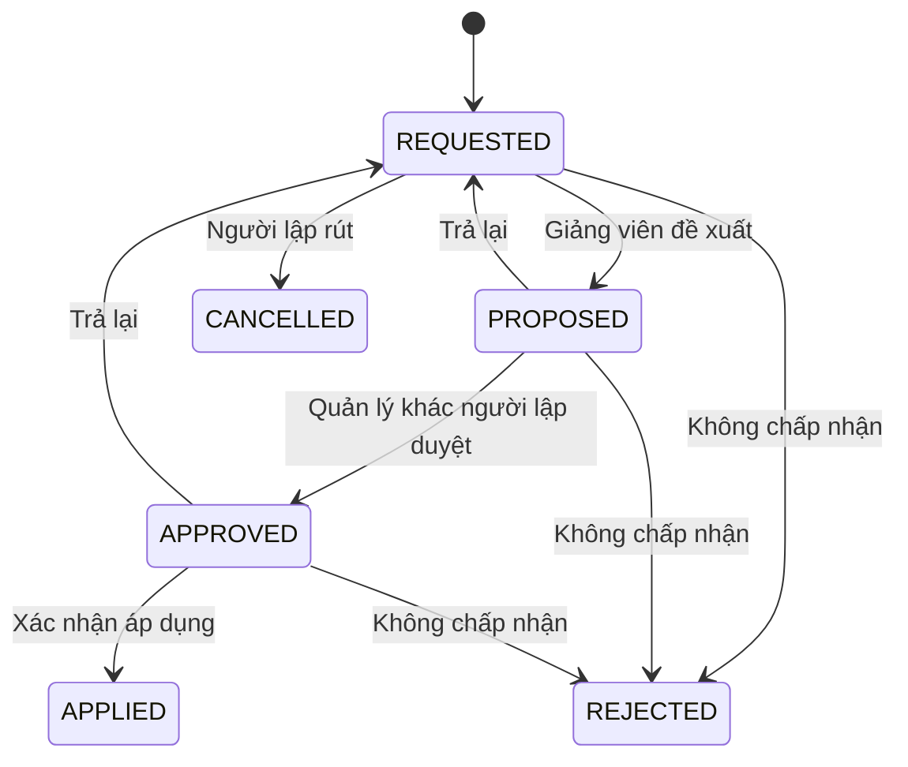

# Phúc khảo và điều chỉnh điểm

Điểm đã công bố không sửa trực tiếp trong bảng nhập điểm. Mỗi yêu cầu có điểm gốc đã chốt, người xử lý, lý do và lịch sử. Phê duyệt chỉ xác nhận nội dung đề xuất; áp dụng là bước riêng cập nhật kết quả.

## Phân công

| Vai trò | Thao tác |
| --- | --- |
| Sinh viên | Xem kết quả công bố của mình; gửi phúc khảo trong đợt mở; rút khi chưa có đề xuất; theo dõi kết quả |
| Giảng viên | Lập yêu cầu điều chỉnh và đề xuất cho lớp hiện được giao; đối chiếu từng điểm thành phần hoặc giữ nguyên điểm |
| Nhân viên | Lập và đọc yêu cầu trong phạm vi sinh viên được giao; không đề xuất, duyệt hoặc áp dụng điểm. Nhân viên toàn trường được quản lý đợt phúc khảo |
| Quản lý | Thiết lập đợt, lập yêu cầu, trả lại, không chấp nhận, duyệt và áp dụng. Không tự duyệt hồ sơ mình lập hoặc đề xuất; hồ sơ do Quản lý lập cần Quản lý khác duyệt |

Đợt theo học kỳ có giờ mở/đóng rõ ràng, hiển thị giờ Việt Nam. Thiếu cấu hình hoặc ngoài đợt thì Sinh viên không gửi được; không tự giả định thời hạn. Yêu cầu điều chỉnh của cán bộ/giảng viên là nghiệp vụ riêng, không lệ thuộc cửa sổ phúc khảo của Sinh viên.

## Trạng thái

Các bước ghi đều cần xác nhận; trả lại hoặc không chấp nhận cần lý do. Trả lại xóa hiệu lực phê duyệt, giữ diễn biến cũ. Mỗi kết quả chỉ có một hồ sơ đang xử lý. Gửi lại cùng mã yêu cầu không tạo bản ghi trùng.

Ví dụ: kết quả 8/10 được đề xuất thành 9/10. Khi duyệt, trang vẫn hiện điểm hiện tại 8 và trạng thái Đã duyệt · Chưa áp dụng. Sau xác nhận áp dụng mới chuyển điểm thành 9 và lưu cả hai bản. Nếu kết luận giữ nguyên, hồ sơ vẫn đóng và lưu quyết định, nhưng không tăng phiên bản điểm hoặc báo là điểm đã thay đổi.

## Giữ căn cứ của điểm công bố

- Tính lại bằng trọng số, tín chỉ, ngưỡng đạt và bảng quy đổi đã chốt trong kết quả gốc; không dùng quy định mới để đổi nghĩa điểm cũ.
- Trước mỗi bước kiểm tra phiên bản và toàn bộ nội dung điểm gốc. Khi áp dụng còn kiểm tra giảng viên vẫn được giao lớp, tài khoản đề xuất/phê duyệt còn hiệu lực và dấu xác nhận đúng nội dung. Dữ liệu đổi thì chặn hồ sơ cũ, không âm thầm thay bằng bản mới.
- Dữ liệu cũ có điểm tổng kết trực tiếp vẫn sửa tổng kết được; thiếu căn cứ hệ 4 thì GPA tiếp tục Chưa xác minh. Kết quả khai báo cách tính thành phần nhưng mất snapshot không được tự suy trọng số.
- GPA được tính từ điểm hiện hành sau áp dụng; những lần kiểm tra tiên quyết tiếp theo dùng điểm mới. Không tự xóa đăng ký đã tồn tại, thay quyết định tốt nghiệp hoặc chạy xử lý kỷ luật.
- Ghi điểm, lịch sử, nhật ký và mã chống lặp trong một giao dịch. Lỗi ghi nhật ký phải hủy cả thay đổi. Lịch sử điểm chỉ thêm, không có API cập nhật/xóa.

## Mã nguồn và API

Giao diện: `frontend/app/features/grade-reviews.js`, route `#grade-reviews`. Dịch vụ: `backend/local/modules/grades/grade-review.service.js`; controller cùng thư mục. Trang có tìm kiếm, lọc trạng thái, phân trang, xuất CSV theo quyền, so sánh thành phần và lịch sử xử lý. LizzChat có công cụ đọc `lookup_grade_reviews`, chưa có công cụ sửa hoặc duyệt điểm.

| Phương thức | Đường dẫn dưới /api/v1 | Chức năng |
| --- | --- | --- |
| GET | /grade-reviews | Danh sách, quyền thao tác và kết quả đủ điều kiện gửi |
| POST | /grade-reviews/periods | Lưu đợt phúc khảo |
| POST | /grade-reviews/requests | Lập yêu cầu |
| GET | /grade-reviews/requests/:id | Chi tiết và dấu kiểm tra nội dung |
| POST | /grade-reviews/requests/:id/propose | Đề xuất hoặc giữ nguyên |
| POST | /grade-reviews/requests/:id/approve | Phê duyệt |
| POST | /grade-reviews/requests/:id/apply | Áp dụng kết quả đã duyệt |
| POST | /grade-reviews/requests/:id/return | Trả lại rà soát |
| POST | /grade-reviews/requests/:id/reject | Không chấp nhận |
| POST | /grade-reviews/requests/:id/cancel | Rút yêu cầu |

Các lệnh ghi dùng `requestId` UUID, `confirm: true`; cập nhật dùng `version`, duyệt/áp dụng có `reviewHash`. Không nhận quyền từ nội dung chat hoặc trường do trình duyệt tự khai.

## Database và nâng cấp

Migration mới `011_grade_reviews.sql` chỉ thêm ba bảng:

| Bảng | Nội dung và liên kết |
| --- | --- |
| grade_review_periods | Một cấu hình đợt mỗi học kỳ, tham chiếu academic_terms |
| grade_review_requests | Tham chiếu điểm, sinh viên, lớp, người lập/đề xuất/duyệt; đóng băng điểm gốc, đề xuất và lịch sử. Cột sinh active_grade_id có unique để chặn hai hồ sơ đang xử lý cho cùng điểm |
| grade_revisions | Tham chiếu hồ sơ duy nhất, điểm, sinh viên và người áp dụng; lưu toàn bộ trước/sau, lý do và thời điểm |

Giữ MySQL 8.0.16+, InnoDB, utf8mb4/utf8mb4_unicode_ci. Sao lưu rồi chạy `npm run db:migrate` trên bản sao trước; giữ nguyên migration 001–010. Chưa được chạy DDL 011 trên MySQL thật trong môi trường hiện tại. Không xóa dữ liệu cũ để giải quyết lỗi nâng cấp.

## Bằng chứng và phần còn thiếu

21 kiểm thử mới kiểm tra thời hạn, chủ sở hữu/phạm vi, phân công, maker-checker, trả lại/rút/từ chối, giữ nguyên, snapshot, GPA, tiên quyết, dữ liệu cũ, bản cũ, retry, cạnh tranh trên kho bộ nhớ, rollback, HTTP/Origin, AI đọc theo quyền và whitelist SQL. Toàn bộ suite 162/162 PASS.

Trình duyệt đã đi qua gửi yêu cầu → đề xuất → duyệt giữ nguyên điểm hiện tại → áp dụng đổi điểm → xem lịch sử bằng component thật với API dữ liệu tổng hợp riêng. Đây là kiểm tra giao diện, không chứng minh ghi MySQL thật. Bộ dựng dữ liệu kiểm tra đã được gỡ khỏi nguồn giao diện bàn giao.

Chưa nghiệm thu migration, lưu qua khởi động lại và cạnh tranh bằng nhiều kết nối SQL; Gemini thật chưa đủ cấu hình. Chưa có tệp minh chứng bài thi, lệ phí phúc khảo, hội đồng độc lập, duyệt nhiều cấp hoặc thông báo tự động. Các phần này không được coi là đã hoàn tất. Ưu tiên tiếp theo là lịch nhiều buổi, phòng học và ngoại lệ; tiếp tục nghiệm thu DB/AI khi có môi trường.
